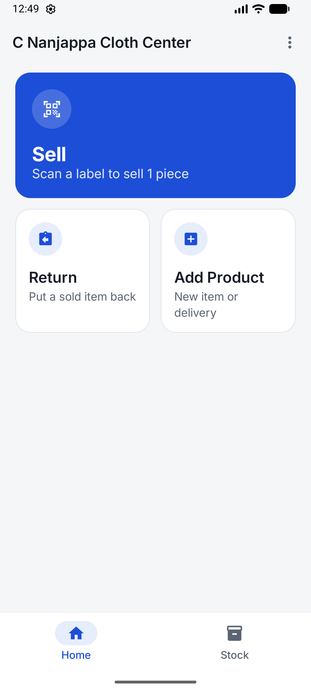
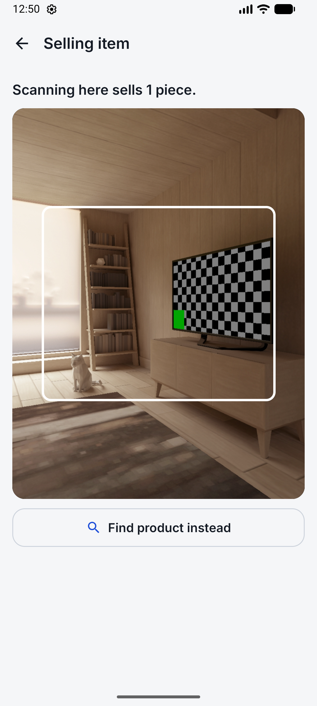
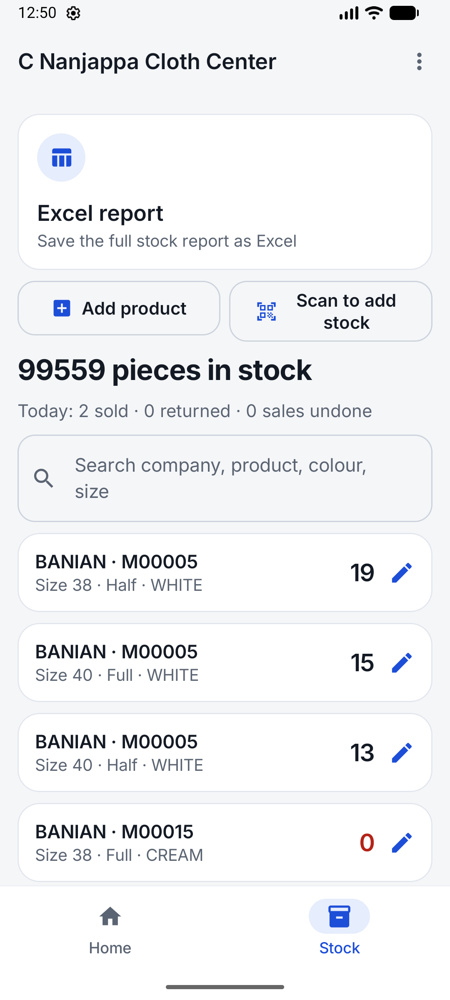
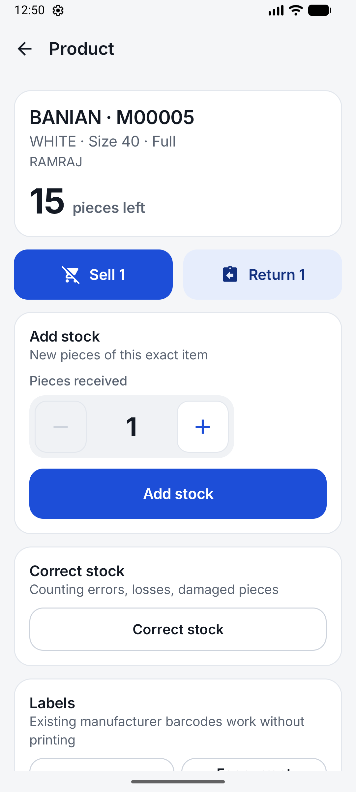
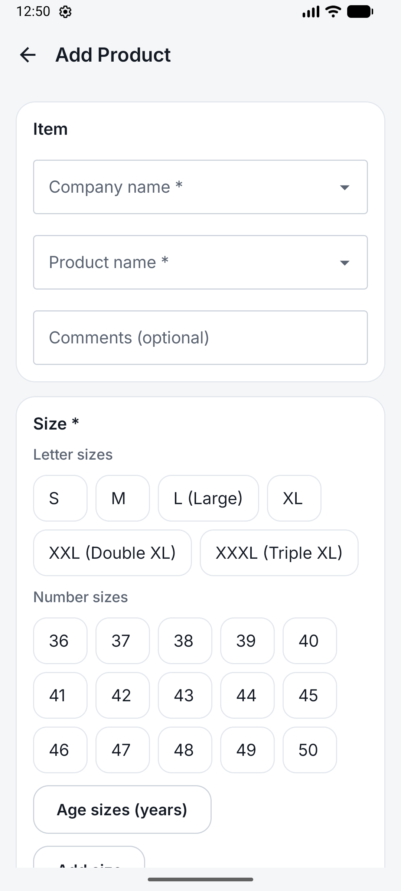
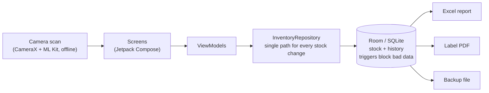
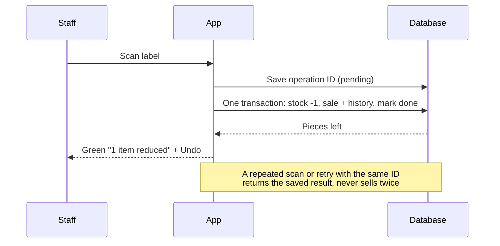

# C Nanjappa Cloth Center — Inventory

Offline Android app for a clothing shop. Scan a garment's barcode to sell it, add products and stock, record returns, and export Excel reports, labels and backups. No internet, account or subscription needed.

| Home | Sell (scanner) | Stock | Product | Add Product |
|---|---|---|---|---|
|  |  |  |  |  |

Screenshots are from the emulator with stress-test data. The scanner shows the emulator's virtual room in place of a real camera.

## Features

- **Home:** just Sell, Return and Add Product. Everything else is in the Stock tab.
- **Sell by scanning:** each scan sells exactly 1 piece, with Undo. A label held in front of the camera never sells twice.
- **Uses existing barcodes:** EAN, UPC, Code 128/39, QR and Data Matrix. A number typed in matches the same number scanned in any of these formats.
- **One barcode, one item:** a barcode already on an item is refused when you scan or type it for another one.
- **Generate a barcode:** for tags without one. Makes a new EAN-13 in the in-store range (starts with 2, never on manufacturer goods), never the same number twice. Labels print it as EAN-13.
- **Returns:** only against a recorded sale, including damaged returns.
- **Products:** company name, product name, size, Full/Half and colour are required, plus a barcode. Comments and notes are optional. Company and product are picked from a dropdown of saved names, or added new. All text is saved in capitals.
- **Stock tab:** Excel report at the top, then one row per item (size · Full/Half · colour · pieces). Tap a row to open it, ✎ to edit every field, including quantity (saved in History as a correction) and barcodes.
- **Delete item:** removes it from stock, search and scanning, and frees its barcodes and name. Past sales stay in History and Excel.
- **Exports:** Excel stock report, barcode label PDF (from the product page), and checked backup and restore.
- **Automatic backup:** every night around 11 PM, if anything changed, to `Download/CNCC Backups` on the phone (visible in the Files app, kept if the app is uninstalled). The last 14 are kept. Copy one off the phone now and then.

## How it works





## Build and run

You need Android Studio (or its bundled JDK). Phones need Android 8.0 or newer.

```bash
git clone https://github.com/dhyanagni2001-commits/CNCC_Inventory_Android.git
cd CNCC_Inventory_Android/MyApplication
export JAVA_HOME="/Applications/Android Studio.app/Contents/jbr/Contents/Home"

./gradlew :app:assemblePreview    # optimised test build
adb install -r app/build/outputs/apk/preview/app-preview.apk
adb shell cmd package compile -m speed-profile -f com.cnanjappa.inventory   # optimise now (see below)
```

An APK installed over USB, or from a file, runs unoptimised until Android compiles it in the background (when the phone is idle and charging, usually overnight). Until then screens open noticeably slower. The `compile` line does it straight away; run it after every install.

### Keeping it smooth on the shop phone

Measured on a Galaxy M32: the uncompiled app took up to 250 ms per frame when opening Add Product; compiled, about 20 ms. The phone itself was also overloaded (load about 4× its 8 cores, 1.4 GB swap) by other apps.

1. Run the `compile` line after every install (or leave the phone idle and charging overnight).
2. Use the phone for the shop only: uninstall or disable heavy apps (social media, games), and close recent apps.
3. Settings → Battery → turn **Power saving off** while the shop is open (it slows the CPU, and the scanner reads less often).
4. Settings → Apps → CN Cloth Center → Battery → **Unrestricted**.
5. Keep at least 15% storage free, and restart the phone once a day.

The release APK (`./gradlew :app:assembleRelease`) must be signed with the shop's own key. This repository contains no keys.

Each release build copies its APK and R8 mapping file to `MyApplication/release-artifacts/<version>/`. Keep that folder for every version you hand out: crash reports from that version can only be read with its mapping file. The installed version is shown at the bottom of the app's menu (⋮).

### Smoke test of the optimised build

```bash
cd MyApplication
scripts/smoke.sh                            # builds preview, installs over the app (data kept), checks it
APK=path/to/signed-release.apk scripts/smoke.sh   # same checks on the signed release
```

Some bugs only appear after R8 shrinks the app, and the normal tests run on the debug build, so run this before every release. It opens the main screens, starts the scanner, builds the Excel report and checks for crashes. It changes no stock. Report saved in `test-results/`.

## Tests

```bash
./gradlew :app:testDebugUnitTest          # 29 unit tests, no device needed
./gradlew :app:connectedDebugAndroidTest  # 46 device tests, needs an emulator or phone
```

All 73 tests pass on the emulator (API 37, 12 Oct 2026); the 2 opt-in demo and stress tests skip themselves. `ScanSellE2ETest` draws real labels (all 8 formats), reads them with the app's scanner and sells them. The tests run in a separate `.debug` app, so they never touch real shop data.

### Stress test (10,000 products)

```bash
cd MyApplication
scripts/stress.sh 300             # 300 = seconds of UI scrolling; report saved in test-results/
SKIP_DB=1 scripts/stress.sh 300   # rerun the UI, idle and random-tap phases without reseeding
```

It adds 10,000 products to the `.debug` app, then runs 5,000 stock changes, sale races, searches, an Excel export and a backup. It checks every quantity against its own count, then scrolls the app, checks it in the background and does 3,000 random taps.

Results on the emulator (API 37, 8 Oct 2026). Times are typical / 95th percentile:

| Action | 10,000 products | 100,000 products |
|---|---|---|
| Scan + sell | 1.8 / 6 ms | 1.9 / 5 ms |
| Return / undo / restock | 1–1.5 / 3–4 ms | 1.4–1.5 / 2–5 ms |
| Stock tab search | 10 / 20 ms | 217 / 299 ms |
| Products search | 6 / 10 ms | 69 / 104 ms |
| Full Excel export / backup | 3.4 s / 3.2 s | 23 s / 22 s |
| Database / Excel / backup size | 9.9 / 1.0 / 3.1 MB | 80 / 7.9 / 22 MB |

- **Correctness at both sizes:** 0 stock mismatches, stock history matches every quantity, and each of 50 "last piece" races sold exactly once. A repeated tap did not sell twice.
- **Search:** at 100,000 products the slowest search is 299 ms for 1 in 20 searches, under the 500 ms limit, so switching to full-text search is not needed yet. The Stock tab search is the slowest part because it totals sizes across all products for every search.
- **Stability:** 3,000 random taps and swipes at each size, with no crash and no "app not responding". Memory stayed at about 20 MB Java and 25 MB native.
- **Battery (estimate):** nonstop scrolling used 13–23% of one CPU core at 10,000 products and 41% at 100,000. On a phone with a 5,000 mAh battery, 10,000 products works out to about 0.5–2% per hour from the app; the screen itself uses more, about 3–8% per hour. In the background the app uses no CPU, holds no wakelocks and has the camera closed. The emulator has no real battery, so these figures need checking on a phone.
- **Smoothness:** inconclusive on the emulator. Many frames are late on both builds (52% optimised `preview`, 64% debug, in the same test). The optimised build halves the frames slowed by app code; most of the rest come from the emulator's graphics layer. Needs measuring on a real phone.

To test the optimised build with stress data, restore `/sdcard/Android/data/com.cnanjappa.inventory.debug/files/stress.cncbak` in the app (Menu → Backup → Restore backup), then run `SKIP_DB=1 PKG=com.cnanjappa.inventory scripts/stress.sh 180`.

### Continuous use (12 Oct 2026, emulator, 10,000 products)

30 rounds of real use (Add Product, Stock list and search, product page, Sell camera; about 10 minutes), then 3,000 random taps and swipes:

| | Real use | Random taps |
|---|---|---|
| Frames on time | 93%, slowest 1% at 20 ms | 86%, slowest 1% at 34 ms |
| Hangs (ANR) / crashes | 0 / 0 | 0 / 0 |
| Memory | 29 → 34 MB | 52 MB, steady (app data 7 MB; the rest is the scanner model and camera, loaded once) |

**Not yet verified:** battery and heat on a real phone, scanning a wide range of real garment labels, and printing. On the shop phone, run the `compile` command after installing, and keep few other apps running (see "Build and run"). The app and scanner do run on a Samsung Galaxy M32 (Android 13).

## Project layout

```
MyApplication/app/src/main/java/com/cnanjappa/inventory/
├── domain/   size, colour and barcode rules
├── data/     database and InventoryRepository
├── scan/     camera barcode scanner
├── export/   Excel, labels, backup
└── ui/       screens
```

Release readiness, check by check: [RELEASE_CHECKLIST.md](RELEASE_CHECKLIST.md). Still needed before release: the shop's signing key, and tests of labels and printing.

For more detail, see [MyApplication/NOTES.md](MyApplication/NOTES.md) and [android_inventory_requirements.md](android_inventory_requirements.md).

## Licences

AndroidX, Compose, Room, CameraX and ZXing are under Apache 2.0. The Inter font is under SIL OFL 1.1 (see [licence](MyApplication/INTER_FONT_LICENSE.txt)).
